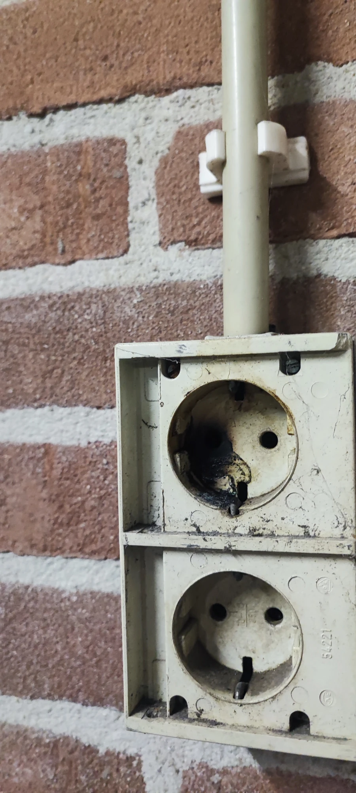
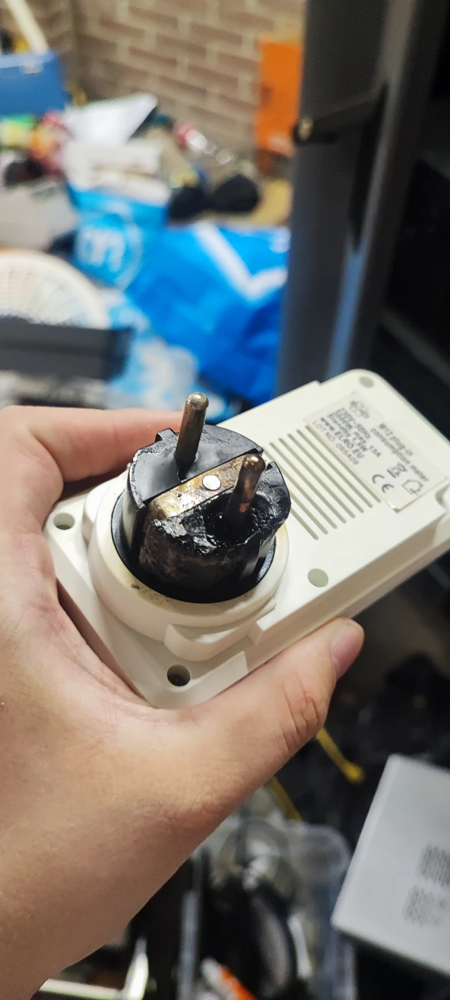
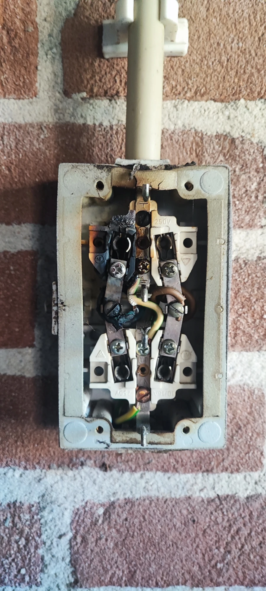
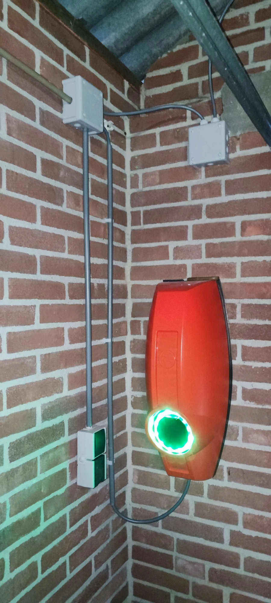
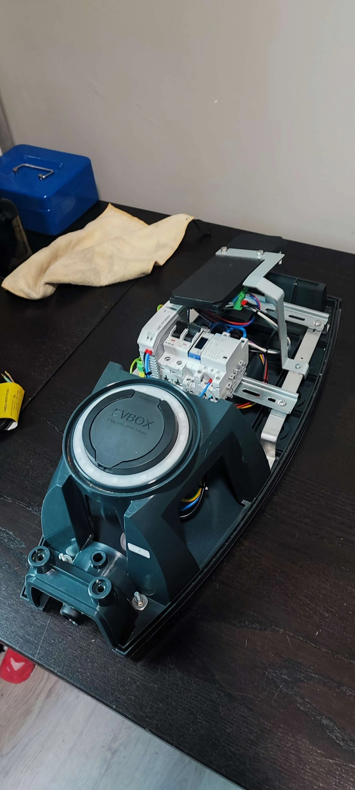
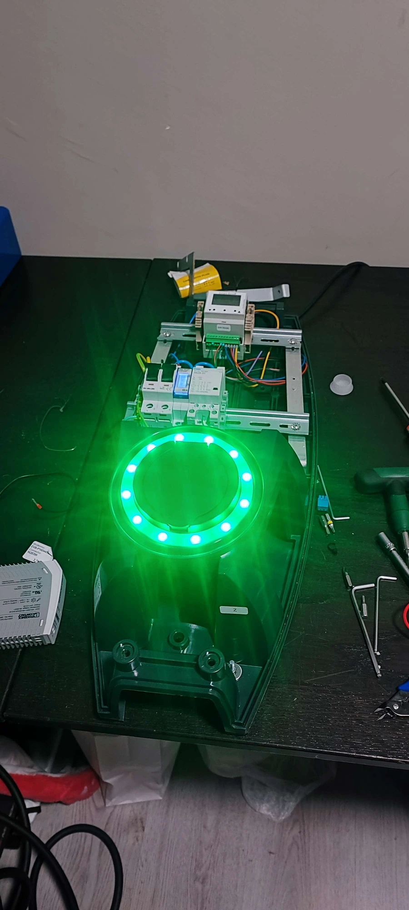
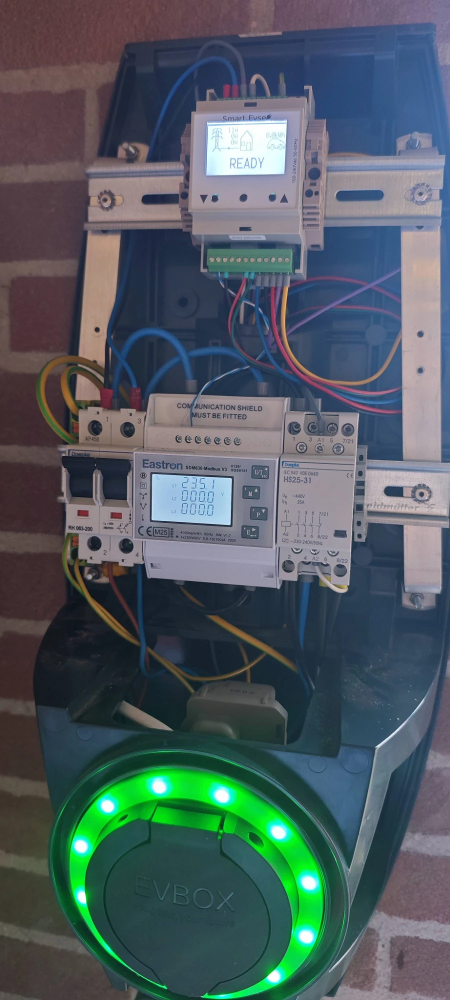

It started with the granny charger that came with my old Leaf. It nearly burned down my garage.

I walked into the garage one day and the FAULT light on the charger was on. Confused as hell, I went to check and unplugged everything. This is what I found:

The setup was simple: the charger went into a cheap plug-in energy meter, so I could see what each session used, and the meter went into an old socket in the garage. The charger pulls 10 A, for hours at a time. On paper that's fine: the meter is rated for 13 A and the socket for 16 A. In practice, hours of 10 A through a cheap plug and a tired socket turns into a lot of heat in a very small spot.

Opening the socket up afterwards showed how close it actually got. The contact had cooked, and the insulation on the wire next to it had melted.

Lucky that's all it did. So yeah: time to upgrade to something proper.

## A €50 EVBox

A new wallbox cost several hundred euros at the time. Instead, I found a second-hand EVBox BusinessLine on Marktplaats for €50, back at the end of January 2023. It came from an old ING office, which is why the cover is bright ING orange. (Still need to paint that thing.)

## What was inside

Opening it up, there wasn't much to it:

- the controller: a big black box (and I mean that literally, it's a big black rectangle)
- a small kWh meter
- a mains switch
- a contactor
- a 12 V power supply

The basic hardware was fine. The part that made it an EVBox was the controller, so that's what had to go.

## New brains: SmartEVSE

The big black box got replaced with a SmartEVSE v3 from Stegen.

Somewhere around June to August 2025 I also swapped the old meter for an Eastron SDM630 Modbus V3 and connected it to the SmartEVSE. Now I can see exactly how much each charging session used.

Later on I went back in and rewired the whole thing in 4 mm² cable.

## RFID and guest charging

I added the RFID reader from Stegen's site, so the charger reads official charge cards and tokens. That's not just for locking it: it means guests can use their own card and get billed for it. The billing side is handled by Tap Electric over OCPP.

## Safety

Since the charger hangs off my existing garage electrical system, I added a DC/AC residual current sensor from Stegen, the RCM14-01. A regular RCD can't reliably detect DC fault currents, and an EV charger can produce those, so this one watches for both.

I fitted it during the rewire, and my god, routing the three phases and the neutral through it was a pain. All four cables have to pass through the sensor's hole, and they barely fit. Literally barely.

## Where it's at now

It's been running okay since the end of January 2023. Mostly.

Every now and then it loses its Wi-Fi connection. No Wi-Fi means no OCPP, so card authentication stops working and nobody can start a charge. The only fix so far: a hard reboot of the whole thing.

So that's the next upgrade: installing the new Ethernet module and hardwiring it. And after that, finally painting that orange thing.
